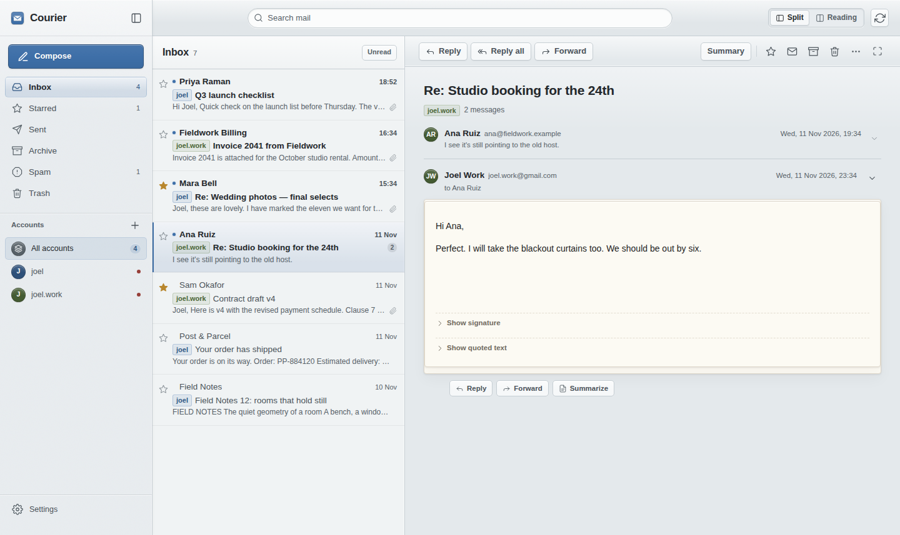
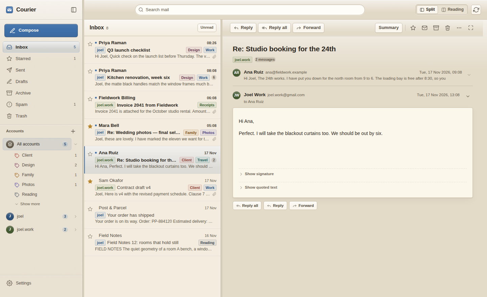
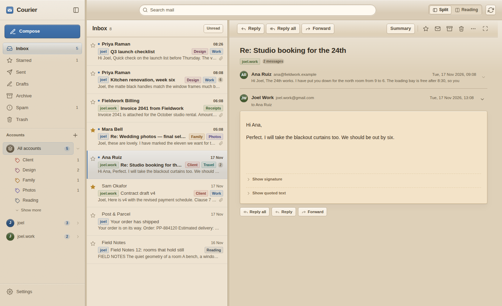
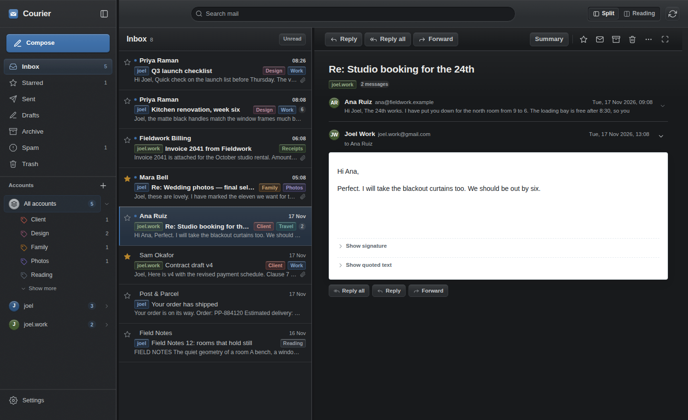
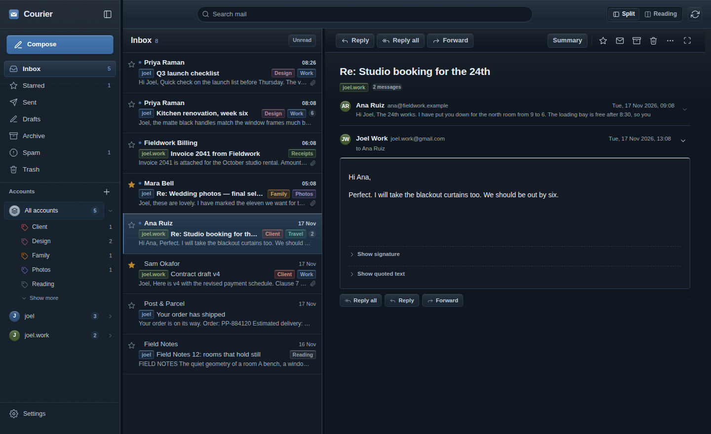

# Courier

[](https://github.com/joelis10/courier/actions/workflows/debian.yml)

[](LICENSE)

A local Gmail client for Linux. Multiple Gmail accounts share one inbox, mail renders in
the system WebKitGTK view, and everything is stored on your machine. There is no bundled
Chromium, no Electron, no Node runtime, and no calendar.



<details>
<summary>More theme combinations</summary>

| Window and email paper | Window and email paper |
| :---: | :---: |
| [](docs/themes/linen.png)<br>**Linen** window, **Linen** email | [](docs/themes/sepia.png)<br>**Sepia** window, **Sepia** email |
| [](docs/themes/graphite-fog.png)<br>**Graphite** window, **Fog** email | [](docs/themes/midnight.png)<br>**Midnight** window, **Midnight** email |

</details>

## What it does

- Merges any number of Gmail accounts into one inbox, with per-account colours, badges,
  labels, and custom views.
- Reads, searches, archives, stars, labels, and trashes mail without leaving the desktop.
- Sends replies, reply-alls, forwards, and new messages with attachments and inline images.
- Saves drafts to Gmail while you type and restores them with recipients and attachments.
- Adds a per-account rich text signature from Settings, with formatted text and inline
  images, and inserts it below the message text in new messages and replies.
- Guides first-time Gmail setup with a step-by-step Google Cloud modal and client JSON
  import, then verifies the granted scopes.
- Folds signatures and quoted replies, blocks remote images by default, and renders each
  message in a sandboxed WebKit frame.
- Keeps running in the tray, checks for new mail on a 10-second, 1-minute, or manual
  schedule, and sends desktop notifications with an optional one-line AI summary.
- Checks GitHub for new Courier releases manually or automatically every 1, 5, or 8 hours;
  automatic checks are off by default. Installed packages can download and apply a newer
  release from Settings → Updates, then restart Courier when prompted.
- Resizes inline images with corner handles or the image menu, which can also move an image
  out of the body and into the attachment list, or delete it.
- Has five client themes, five email content themes, resizable panes, split/reading/full
  screen views, and keyboard shortcuts.
- Talks directly to any OpenAI-compatible endpoint for on-demand summaries. AI is off by
  default, requires an explicit acknowledgement, and no summary runs without a click.

Courier asks Google only for Gmail modify and send access. It does not request Calendar,
Contacts, or Drive.

## Requirements

- Python 3.11 or newer
- GTK 3, PyGObject, WebKitGTK 4.1, and libnotify
- A Google Cloud project with an OAuth client of type **Desktop app**

On Debian 12 or LMDE 6:

```sh
sudo apt install python3 python3-gi gir1.2-gtk-3.0 gir1.2-webkit2-4.1 gir1.2-notify-0.7
```

`ffmpeg` is recommended for notification sounds. Courier also falls back to `paplay`,
`pw-play`, or `aplay` when `ffplay` is unavailable.

There are no pip packages and no Node build step.

## Install

### Debian package

Download the latest `.deb` from [Releases](https://github.com/joelis10/courier/releases),
then install it:

```sh
sudo apt install ./courier_*_all.deb
courier
```

The package is architecture-independent. It installs the application, desktop launcher,
icon, and manual page, and pulls in Python 3, PyGObject, GTK 3, WebKitGTK 4.1, and
libnotify. Polkit and xdg-utils are recommended so the in-client updater can run the
package installer. Release packages are built from source by the
[Debian package workflow](.github/workflows/debian.yml).

After installing the package, later releases can be downloaded and applied from
**Settings → Updates**. Courier verifies the release checksum, asks for system
authorisation, and offers to restart when the package is installed. A source checkout is
never replaced by this flow.

To remove the app while keeping your mail database:

```sh
sudo apt remove courier
```

### From source

```sh
git clone https://github.com/joelis10/courier.git
cd courier
./run.sh
```

The window opens against the right edge of the desktop so it can sit beside a browser or
chat window. For a terminal session with WebKit's inspector:

```sh
COURIER_DEV=1 ./run.sh
```

To add a menu launcher for this checkout:

```sh
./install.sh
```

`./install.sh --uninstall` removes the launcher and autostart entry but leaves the mail
database alone.

### Build a Debian package

```sh
./packaging/build-deb.sh 1.0.0-1 dist
sudo apt install ./dist/courier_1.0.0-1_all.deb
```

The workflow builds a `.deb` on every push and pull request, uploads it as an artifact,
and attaches it to a GitHub Release when a tag such as `v1.0.0` is pushed. It uses the
standard Ubuntu 24.04 GitHub-hosted runner. GitHub does not charge for standard runner
minutes or artifact storage on public repositories.

## Connect Gmail

Courier does not ship a Google client secret. It uses a Desktop OAuth client created in
your own Google Cloud project.

On first launch, Courier opens a six-step **Connect Gmail** guide. It links directly to
the relevant Google Cloud pages and walks through:

1. Create or select a Google Cloud project.
2. Enable the Gmail API.
3. Configure Google Auth platform branding and test users.
4. Add the Gmail and sign-in scopes.
5. Create a Desktop app OAuth client.
6. Download and import the client JSON.

The guide validates the imported JSON, rejects Web application clients, and checks the
Desktop client fields. After the Google sign-in it verifies that the account granted the
requested scopes; missing permissions are listed with a **Reconnect** action.

Reopen the guide at any time from **Settings → Accounts → Open setup guide**. Importing a
different JSON warns first that it will replace the configured client and that connected
accounts may need to reconnect.

Courier opens the consent screen in your default browser and receives the callback on a
local loopback port. The callback port is generated when the app starts. Desktop OAuth
clients accept loopback ports, so there is no redirect URI to configure by hand.

Accounts share the unified inbox; every subject line carries a small badge with that
account's username. Right-click an account in the sidebar and choose **Customize account**,
or click **Edit** in Settings, to change its badge username, colour, **Outgoing name**,
default view, or signature. The signature toggle reveals a rich text editor with a sample
message above it, so images and formatting can be checked in context. Signature images are
sent inline and the signature is added below the message text in new messages and replies.
The signature remains editable in the composer; changing the From account replaces it with
that account's signature. The composer and signature editor use the selected email content
theme for plain text and switch to white paper when styling or images are present, matching
what recipients see.

The outgoing name is the display name used in the From header for new
messages; already-sent messages keep the name they were sent with. If recipients still see
an old name, update **Send mail as** in Gmail's account settings as well. The full address
is still shown in Settings and in the badge tooltip. The signed-in app can remain
unverified while it is in Testing, and Google will show its usual warning for unverified
apps.

Google expires refresh tokens after 7 days for external apps whose publishing status is
Testing. Courier will flag the account as expired and Settings will offer Reconnect. To
avoid weekly reconnects, complete Branding and select **Publish app** on the
**Audience** page. Publishing is free, and Google does not charge a verification fee. For
personal use or a limited audience under 100 users, verification is optional: users can
click through the unverified-app warning, subject to the 100-user cap. Wider public
distribution may require verification, and verified apps that handle restricted Gmail data
on remote servers may need a third-party CASA security assessment, which is paid to the
assessor. Reconnect each account after publishing so it receives a production refresh
token. A Google Workspace project with an Internal user type avoids the 7-day limit, the
warning, and verification, but is only available inside a Workspace organization.

Courier asks only for Gmail modify and send access, plus the basic OpenID profile used for
the From name. It does not request Calendar, Contacts, or Drive.

## Refresh

Courier checks Gmail as soon as it opens and then continues in the background. In
**Settings → Mail**, **Check for mail** can be set to every 10 seconds (the default), every
minute, or manual. The app also checks the local state every few seconds, so new mail
normally appears within 15 seconds.

Gmail's instant push notifications require a publicly reachable Pub/Sub webhook. A
local-only desktop client cannot receive those without a relay, so Courier uses Gmail
history polling. At the 10-second setting it checks each account six times per minute,
well inside Gmail's documented API quotas. Choose the minute or manual option if you
prefer fewer network requests. Manual refresh is always available from the toolbar.

## Tray and startup

Courier keeps a tray icon so it can continue checking mail while the window is hidden.
Left-click the icon to open the window. Right-click it for the number of new emails since
the window was last opened, each account, and Quit. Choosing an account opens that
account's inbox. The application-menu icon also raises the running window instead of
starting a second copy.

**Settings → Window** controls what happens when the window is minimised or closed, and
whether Courier starts at login:

- Minimise normally, or hide to the tray.
- Close to quit, or keep running in the tray.
- At login, do not start, start minimised in the tray, or start with the window open.

The login option writes an XDG autostart entry under `~/.config/autostart/`. Running with a
custom `COURIER_DATA_DIR` or demo mode does not modify the autostart folder.

## Notifications

Courier notifies you when a new unread incoming message arrives, including one that lands
in the thread currently open or last open when the window was minimised. The default sound
is a quiet two-tap knock; other built-in sounds include a bell, message, completion chime,
attention sound, the system beep, and none. You can upload a WAV, OGG, MP3, FLAC, or M4A
file as a custom sound in **Settings → Notifications**. Built-in sounds have a volume
slider.
Courier asks the notification daemon to suppress its own sound so only the chosen Courier
sound plays. **System notification sound** deliberately does the opposite: Courier does
not suppress the daemon and does not play a sound itself, leaving the daemon's configured
sound in charge.

Clicking a notification opens the thread it came from, in the account that owns it.
Test notifications do not open anything.

Archived mail stays quiet by default. Turn on **Archived mail** under notification
settings to be notified about threads without the Inbox label.

Notification settings include:

- archive notifications, off by default;
- show or hide the account badge and use the same before/after sender or subject
  placement as the mail list;
- send a test notification using the current settings;
- use the configured AI endpoint for a one-line summary instead of the normal preview,
  only when the message is longer than a chosen character threshold. The AI gets eight
  seconds; if it fails or times out, the regular sender/subject/preview notification is
  sent instead. The length setting stays hidden until AI notifications are enabled, and
  account-placement controls stay hidden when the account badge is off.

## Reading and writing

- **Accounts own their labels.** Expand an account in the sidebar to see its labels, five
  at a time with **Show more**. **All accounts** is expandable too and shows merged labels.
  Labels with no recently synced threads still appear; selecting one fetches its mail.
  Labels stay alphabetical even when their counts change. Switching accounts collapses
  the account you left and expands the one you selected. The chevrons still expand or
  collapse any account independently.
- Account badges disappear while a single account is selected; labels stay on the cards.
  Label chips use the same before/after sender or subject placement as account badges,
  and the account badge comes first when both share a position.
- The **Unread** filter keeps the thread you open visible and selected even after it
  becomes read. It leaves the list when you return to the list or open another thread.
- Right-click a thread for **Summarize all**, **Summarize unread** when unread mail exists,
  **Mark as read/unread**, **Mark as spam**, **Archive**, and **Delete**. Delete moves the
  thread to Gmail's Trash. Marking the open thread unread closes the reader. Summaries open
  in a small panel at the pointer instead of replacing the reader. Drag the summary title
  bar to move it; the first click away closes it without activating anything underneath.
- Right-click an account for quick customisation, filtering to that account, **Create
  custom view**, or Reconnect. These menus replace WebKit's page menu; normal text fields
  keep their own edit menu.
- Custom views appear under their account, above the labels, with an eye icon. A view can
  include or exclude labels and senders, and apply include/exclude subject regexes. Views
  are local Courier filters; they do not create Gmail filters or move mail. Right-click a
  view to edit or delete it. The account editor has a **Default view** setting, so opening
  an account can land on one of its views instead of the Inbox.
- **More actions** in the reader toolbar has **Copy debug content**. It copies a JSON
  snapshot of the whole thread: raw HTML and text bodies, selected and resolved email
  themes, and signature/quote detection results. It is intended for sending rendering
  problems back for diagnosis.
- **Split** shows the merged list and the reader side by side.
- **Reading** gives the message the full workspace, keeps the action bar at full width,
  and puts the list behind a back button. With no message selected, the list itself spans
  the full workspace.
- Drag the divider beside the sidebar or the message list to resize either pane. The
  widths are remembered across restarts.
- **Full screen** hides the sidebar, search bar, and list. Use the expand icon in the
  reader toolbar or press Escape to leave.
- **Message width** in Settings offers Standard, Wide (the default), and Full. Wide makes
  Reading usefully wider than Split; Full uses the whole reader.
- **Account badge** and **Label** placement can each be set before or after the sender or
  subject. When they share a position, the account badge appears first.
- Opening a thread keeps its subject, account badge, and message count visible while a
  spinner fills only the message area. Once the messages, frames, and images have finished
  laying out, the thread appears without rebuilding the header or action bar. Multi-message
  threads jump once to the top of the latest message instead of drifting as earlier
  content loads; single-message threads stay at the top. If new mail arrives while the
  thread is open, it is fetched and added in place.
- Click a message header in a thread to collapse or expand it, or use the chevron. The
  expansion layout resets when the thread is reopened or refreshed, so older expanded
  messages cannot change the final jump position.
- Reply all, Reply, and Forward below each message are spaced buttons with icons. Reply
  recipients keep their display names; bare addresses are filled from past contacts when
  Courier knows a real name. Cc recipients are shown beside the To summary in the expanded
  message header.
- The main **Compose** button always starts a new, full-height message; reply actions are
  only in the message toolbar and per-message buttons. In the composer, Enter in
  To/Cc/Bcc adds the current address as another recipient; Enter never sends. Use
  **Ctrl+Enter** to send.
- Typing in To/Cc/Bcc shows people from past mail, with name and address. Your own
  accounts are excluded. Use Up/Down to move, Enter to choose, and Escape to close; Tab
  moves to the next field without choosing. Choosing someone fills the current address
  and leaves room for the next recipient.
- The composer formatting bar has Undo and Redo. `Ctrl+Z` undoes and `Ctrl+Shift+Z` or
  `Ctrl+Y` redoes in the message body.
- While a message is sending, a popup at the bottom of the window stays visible with a
  spinner. It changes to **Message sent** when Gmail has accepted the message, or shows
  the error and leaves the composer open if sending fails.
- Attach opens a native file chooser in Downloads and accepts multiple files. Attached
  files appear on a collapsible composer shelf between the formatting bar and Send, with
  View and Delete icons. The shelf expands when files are added, uses multiple columns in
  wider composers, and scrolls internally when it gets tall. Insert image opens the image
  chooser. Sending with a blank subject
  or message asks for confirmation first. If the message mentions an attachment but no
  files are attached, Courier asks for confirmation before sending.
- Inline images are inserted from the toolbar or clipboard. Pasted data/blob images are
  converted to normal inline attachments before sending. Images that are wrapped in links
  open their link; only unlinked images open the lightbox, scoped to the current email.
- Signatures and quoted replies are folded by default. Each is hidden behind its own
  **Show signature** or **Show quoted text** control, so short messages do not disappear
  under contact blocks and legal notices. Summaries appear below the thread; so does the
  offer to summarize a long thread. Scrolling a long summary stays inside the panel.
- Remote images are blocked per message until you select **Show images**. Inline images
  open in a full-screen viewer; multiple images in one message get a thumbnail carousel,
  previous/next controls, and zoom from 100% to 400%. Escape closes it.
- Older mail loads as you scroll the list.
- Each received attachment has **View** and **Download** buttons. View opens it with the
  system default application, or the app chooser when there is no default. Download opens
  a save dialog in Downloads with the attachment's filename.
- Reply and forward open in a tray beneath the message. The tray takes its own space and
  never overlays the email. Switch to the right-side writing panel for a taller workspace;
  the list folds away in panel mode so the message stays readable.
- Composer drafts are saved to Gmail's **Drafts** folder as you type. Drafts stay out of
  the thread reader; they exist only in the composer and the Drafts page. Opening one
  restores its recipients, subject, body, attachments, and inline images into the
  composer. A reply draft opens minimized above the thread; click its header to continue.
  Simply pressing Reply does not create a draft, and pressing Reply again reuses the open
  composer. The trash button in the composer header deletes the current draft after a
  confirmation. Sending removes the draft from Gmail.
- The composer image button inserts inline pictures. They are sent as proper `cid:` MIME
  parts, not as raw data URLs in the message body.
- Right-click an email address link in a message to copy the address, rather than only
  the underlying `mailto:` link.

Keyboard shortcuts: `c` compose, `r` reply, `a` reply all, `f` forward, `e` archive,
`#` trash, `u` toggle read, `s` star, `/` search, `j`/`k` move through the list, Escape
close.

## Themes and accents

Settings has five backgrounds: Fog, Linen, Sepia, Graphite, and Midnight. Accents include
eight presets and a custom colour picker. Theme, accent, layout, and the other interface
preferences are stored in the local database and injected before the page paints, so they
survive restarts.

Email content has its own theme row under **Appearance**, separate from the window:
Fog (the white default), Linen, Sepia, Graphite, and Midnight. Each tile previews the
paper, ink, and rules. It applies to the main body of plain-text messages, including
Gmail's simple `<div>`/`<br>` bodies with no images, tables, or stylesheet. A signature or
folded quoted reply with images or tables does not force the main body onto white paper.
Designed HTML and picture message content keeps its own layout on a neutral white paper
sheet, as do designed signature and quote folds.

Some marketing mail ships a wider desktop table than the reading pane. Courier constrains
over-wide tables and fixed-width blocks to the pane so the message is not clipped. Email
body styles are also sanitised before rendering.

## AI summaries

AI summaries are off by default. In **Settings → AI summaries**, turning on **Enable AI
summaries** opens a confirmation that explains the data flow. Courier does not operate or
control the endpoint you choose; you are responsible for that service, its privacy and
retention terms, and the data you send to it.

Only after that acknowledgement do the endpoint fields appear. Once the endpoint is
configured, the toggle makes the **Summary** and **Summarize** actions available across
Courier — the reader toolbar, thread menus, and the long-thread offer. Reader summaries are
sent only after you choose one of those actions.

Settings accepts any OpenAI-compatible endpoint: a base URL, a model name, and an optional
API key. Examples include OpenAI, a local llama.cpp server, or Ollama's
`http://localhost:11434/v1`.

For a one-message thread the button summarizes that message directly; longer threads offer
the whole thread, the latest message, or unread messages. Threads with five or more messages
show a **Summarize** offer below the thread. The toolbar **Summary** button scrolls down to
the summary panel when it appears. Messages you sent are labelled **You** in the prompt so
the model does not describe your own actions in the third person. Courier removes
signatures and quoted previous messages before building each prompt, so the model receives
the sender, subject, and main message text. Summaries use short bullet points in the order
events happened. A summary that fits without scrolling lets the thread scroll normally;
only an overflowing summary traps the wheel. Requests go from the local backend straight to
your endpoint. The key is kept in the local database and is never sent to the UI after it is
saved.

Notification summaries are the last option in the same AI section. They use the same
endpoint and only run when both AI summaries and notification summaries are enabled. If the
provider does not answer within eight seconds, the normal notification preview is shown.
Notification summaries use the same signature and quote cleaning.

Recent summaries are kept for 30 minutes in the running app, up to ten entries. Returning
to a thread restores its last summary automatically; closing it with the X removes that
cached entry.

No reader summary is generated without a click. Notification summaries are optional and
run automatically only when enabled for notifications.

## Data and security

Runtime files live in `~/.local/share/courier/`:

- `courier.db` stores accounts, OAuth tokens, cached message metadata and bodies, and
  settings.
- `courier.log` records sync and provider errors, without tokens.

The directory is mode 0700 and the database is 0600. Tokens and API keys are stored
plaintext in that database; the permissions are the protection. Remove an account from
Settings to also revoke its Google token.

The HTTP API binds only to `127.0.0.1` and requires a random per-run page token. Email HTML
is sanitised with DOMPurify, then rendered in a sandboxed iframe with scripts disabled and
a restrictive content security policy. Links open in your default browser. Remote images
are blocked until you opt in for that message.

## Development

```sh
python3 -m unittest discover -s tests -v
node --input-type=module --check < app/web/js/body.js
node --input-type=module --check < app/web/js/app.js
```

Build a Debian package locally:

```sh
./packaging/build-deb.sh 1.0.0-1 dist
```

Run only the local server, useful with a normal browser during UI work:

```sh
python3 -m app.main --serve
```

Useful environment variables:

- `COURIER_DATA_DIR` overrides the data directory.
- `COURIER_DEV=1` enables the WebKit inspector and console output.
- `COURIER_GPU=1` leaves WebKit hardware acceleration enabled. By default Courier asks
  for software rendering, which uses noticeably less memory for mail.
- `COURIER_DEMO=1` skips Gmail sync, for use with the sample database.

Create the demo database and run the server against it:

```sh
COURIER_DATA_DIR="$PWD/.dev/demo-data" python3 tests/make_demo.py
COURIER_DATA_DIR="$PWD/.dev/demo-data" COURIER_DEMO=1 python3 -m app.main --serve
```

## Limitations

- Initial sync fetches recent threads for each account. Older mail is available through
  Gmail search and is cached when opened. There is no "download entire mailbox" mode.
- Only Gmail's system folders and user labels are exposed in the sidebar; deeply nested
  label paths are shown flattened.
- Custom views filter locally. They do not create Gmail filters, move messages, or change
  labels, and they only search mail already synced to Courier.
- Permanent deletion is not exposed. Courier uses the Gmail modify scope, which can
  move threads to Trash and back but cannot bypass the trash. Empty the trash in Gmail
  when you need permanent deletion.
- There is no calendar.

## Structure

- `LICENSE` — the MIT license.
- `app/` — Python backend, Gmail client, SQLite store, and web UI.
- `tests/` — core tests and the demo database generator.
- `packaging/` — Debian package builder, wrapper, desktop entry, and man page.
- `.github/workflows/debian.yml` — CI tests and package builds.
- `docs/` — the main screenshot and the theme examples above.

See `AGENTS.md` for the architecture, implementation notes, and where to tune signature
detection if a sender's layout slips through.

## License

Courier is released under the [MIT License](LICENSE). You may use, copy, modify,
publish, distribute, sublicense, and sell the software, provided the copyright notice
and permission notice are included in copies or substantial portions. The software is
provided as is, without warranty of any kind.
